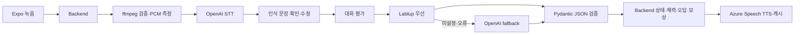

# Malo AI Pipeline

Malo Backend가 호출하는 내부 FastAPI 서비스입니다. FE는 Backend API만 사용합니다.

**[배포 AI 문서](https://inthon-demo-20261031-dh.koreacentral.cloudapp.azure.com/ai/docs)** · [백엔드](https://github.com/2026-INTHON/backend)

캐릭터의 기본 표현 방식은 **고정 원본을 리깅한 정면용 2.5D GLB**입니다. 표정마다 이미지를 다시 생성하지 않습니다. **[움직이는 미리보기](https://inthon-demo-20261031-dh.koreacentral.cloudapp.azure.com/models/)** · [모델·앱 연결 명세](docs/CHARACTERS-25D.md). 기존 이미지 API는 이전에 준비한 이미지의 호환 경로로 유지합니다.

## 파이프라인



| API | 역할 |
|---|---|
| `POST /v1/turns/evaluate` | 문맥·목표·성격을 바탕으로 대화 평가. mock/live |
| `POST /v1/scenarios/generate` | seed 기반 3개 노드 장면 생성, 연결 그래프 검증 |
| `POST /v1/hints` | step=1 관찰 단서 → step=2 가상 캐릭터의 속마음·표현 팁, 추가 LLM 호출 없음 |
| `POST /v1/speech/transcribe` | 파일 검증 → STT → 수정 가능한 문장 + 음성 지표 |
| `POST /v1/speech/synthesize` | Azure TTS, 텍스트·목소리·감정·속도별 캐시 |
| `GET /v1/audio/{asset_id}` | 내부 음성 파일. Backend가 임시 서명 URL로 중계 |
| `GET /v1/persona-assets` | OpenAI 생성 이미지 manifest·assetKey 조회. GET은 생성하지 않음 |
| `POST /v1/images/personas/generate` | 운영자용 OpenAI 캐릭터 생성/표정 편집, 캐시 재사용 |
| `GET /v1/images/{asset_id}` | 저장된 공유 캐릭터 WebP. Backend가 공개 이미지 URL로 중계 |
| `GET /health` | 키 값 없이 준비된 기능 여부만 공개 |

## 비용과 동작

- Mock은 단순 규칙이며 API 비용 0원입니다. Mock 자유 입력 채점은 실제 학습 품질을 대표하지 않습니다.
- `LABLUP_BASE_URL`, `LABLUP_API_KEY`가 있으면 Lablup OpenAI 호환 Chat Completions를 먼저 호출합니다. 현재 Lablup 키는 미설정이며 실제 호출 테스트는 남아 있습니다.
- Lablup 미설정/연결·JSON 실패 시 `OPENAI_FALLBACK_MODEL=gpt-6-luna` Responses API를 한 번 호출합니다. Pydantic 검증 실패/제공자 오류는 재시도 오류이며 틀린 답으로 처리하지 않습니다.
- STT는 `gpt-transcribe`, TTS는 Azure Speech F0입니다. 캐릭터 이미지는 `gpt-image-2.5-flare` Image API로 생성·저장하며 앱 조회는 저장 파일만 읽습니다.
- 기본 일일 한도(KST)는 LLM 1000건, STT 300분, TTS 20만 자입니다. 실제 청구 상한 보장은 아니며 계정의 다른 사용량은 포함하지 않습니다. 제공자 요청 실패도 보수적으로 예약 사용량에 포함됩니다.
- TTS는 캐시, 약 3.1초 요청 간격(20회/분 수준)으로 F0 요청 한도를 배려합니다. 단일 worker 기준입니다. F0 월 50만 자 한도를 다른 앱과 공유하므로 장기 사용 시 콘솔을 확인하세요.
- 한국어는 여자친구 SunHi, 나머지 InJoon. 영어는 Jenny. 영어 지원 감정 스타일만 사용하고 한국어 감정 음성 스타일은 가정하지 않습니다.
- 톤은 **텍스트의 공손함**, 속도는 문자/단어 수 ÷ 녹음 길이, 멈춤은 PCM 낮은 음량 구간의 추정입니다. 감정 진단·발음 정확도 평가는 아닙니다. text/choice는 음성 지표가 없습니다.
- LLM은 상태/체력/재화를 결정하지 않습니다. Backend만 결정합니다. 가상 '속마음'은 캐릭터 설정으로 모델의 내부 추론을 노출하지 않습니다.

## OpenAI 이미지 생성 (추가 원본 제작용)

기본 4명은 `assets/models`의 고정 모델을 사용하세요. 아래 API를 표정·동작마다 호출하지 않습니다. 추가 원본이 필요할 때만 운영자가 사용하며, 현재 일일 생성 한도를 초기화하거나 우회하지 않습니다. 스타일 레퍼런스는 `malo_ai/style-reference.png`이고 기존 이미지 캐시는 자동 교체하지 않습니다.

기본은 **medium / 1024×1536 / 투명 배경 WebP / 요청당 1장**입니다. 캐릭터 4명과 표정 5가지로 범위를 고정했습니다. `neutral`을 먼저 생성하고 나머지는 그 기본 이미지를 참조하는 `/images/edits` 요청으로 만들어 얼굴·의상·구도를 유지합니다. 임의 프롬프트나 high/max 품질을 앱에서 전달할 수 없습니다.

```sh
# 전체 20개 준비. 이미 생성된 항목은 비용 없이 재사용합니다.
python scripts/prepare_personas.py
# 한 항목만 준비
python scripts/prepare_personas.py --character girlfriend --emotion happy
```

운영자가 서비스 토큰으로 호출할 수도 있습니다.

```json
POST /v1/images/personas/generate
X-AI-Service-Token: <server-only token>
{"characterId":"girlfriend","emotion":"happy"}
```

`cached`, `estimatedCostUsd`, `usage`, `referenceAssetId`로 재사용 여부·추정 비용·참조 관계를 확인합니다. 생성 API는 운영자용이며 FE에는 서비스 토큰을 넣지 않습니다. FE는 Backend `/assets/personas`의 `imageUrl`을 사용합니다. 카탈로그와 이미지 GET은 OpenAI를 호출하지 않습니다.

공식 Standard 단가(입력 텍스트 $5/백만 토큰, 입력 이미지 $8/백만, 출력 이미지 $30/백만)로 응답 usage를 계산합니다. 최초 실제 검증에서는 기본 1장 약 **$0.01115**, 표정 편집 1장 약 **$0.023028**이었습니다. 모델·입력별로 달라지는 추정치이며 청구서 확정 금액은 아닙니다. [공식 가격](https://developers.openai.com/api/docs/pricing), [모델·생성 가이드](https://developers.openai.com/api/docs/guides/image-generation).

비용 제어는 **하루 20회** 및 **$2 예약 예산**입니다. 요청 전에 $0.10을 보수적으로 예약하고 실제 추정액이 더 크면 추가 반영합니다. 실패 시에도 예약/횟수를 되돌리지 않아 재시도로 예산이 새지 않게 합니다. 이미 시작된 한 요청의 실제 금액과 계정의 다른 API 사용까지 차단하는 청구 상한은 아닙니다. 캐시 적중은 한도에 포함하지 않습니다.

파일과 manifest는 `MALO_AI_DATA_DIR` 아래 `images/`, `personas/`, 사용량은 같은 폴더의 `usage.db`에 저장됩니다. Docker의 `ai_data` 볼륨에 보존됩니다. 프로세스 재시작 후에도 기존 이미지와 일일 사용량을 재사용합니다.

## 실행

Python 3.12+와 ffmpeg가 필요합니다. Docker에는 ffmpeg가 포함됩니다.

```sh
python -m venv .venv
# Windows: .venv\Scripts\activate / macOS·Linux: source .venv/bin/activate
pip install -r requirements.txt
cp .env.example .env
uvicorn malo_ai.main:app --host 127.0.0.1 --port 8000
```

Swagger `http://localhost:8000/docs`. `MALO_AI_SERVICE_TOKEN`을 Backend와 동일하게 설정하고 `X-AI-Service-Token` 헤더로 전달합니다. production은 토큰 누락 시 호출을 거부합니다. 공개 데모의 서비스 토큰을 FE에 배포하지 마세요.

```sh
python -m unittest discover -s tests -v
python scripts/export_openapi.py
```

## 확장 전 남은 것

Google OAuth 설정은 Backend 인수인계 참조. Lablup 실제 endpoint/key 연결, FE의 캐릭터 이미지 표시, TTS 음색/인격별 프롬프트 품질 조정은 팀 작업입니다. 모델이 반환한 가상 평가를 실제 사람의 성격이나 능력 판단으로 쓰지 않습니다.

해커톤 범위에서는 한 VM/한 Uvicorn worker, SQLite 사용량 장부와 파일 캐시를 사용합니다. 여러 worker/서버로 확장할 때 공유 큐·캐시·사용량 제한을 도입하세요. 현재 업로드 원본은 요청이 끝나면 임시 디렉터리에서 지우며, 변환된 TTS 파일만 캐시합니다.
