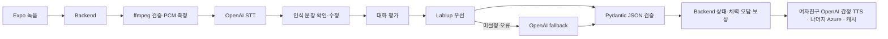

# Malo AI Pipeline

Malo Backend가 호출하는 내부 FastAPI 서비스입니다. FE는 Backend API만 사용합니다.

**[배포 AI 문서](https://inthon-demo-20261031-dh.koreacentral.cloudapp.azure.com/ai/docs)** · [백엔드](https://github.com/2026-INTHON/backend)

캐릭터의 기본 표현 방식은 **고정 원본을 리깅한 정면용 2.5D GLB**입니다. 표정마다 이미지를 다시 생성하지 않습니다. **[움직이는 미리보기](https://inthon-demo-20261031-dh.koreacentral.cloudapp.azure.com/models/)** · [모델·앱 연결 명세](docs/CHARACTERS-25D.md). 기존 이미지 API는 이전에 준비한 이미지의 호환 경로로 유지합니다.

## 파이프라인



| API | 역할 |
|---|---|
| `POST /v1/turns/evaluate` | 문맥·목표·성격을 바탕으로 대화 평가. mock/live |
| `POST /v1/scenarios/generate` | seed 기반 3개 노드 장면 생성, 연결 그래프 검증 |
| `POST /v1/hints` | step=1 관찰 단서 → step=2 가상 캐릭터의 속마음·표현 팁, 추가 LLM 호출 없음 |
| `POST /v1/speech/transcribe` | 파일 검증 → STT → 수정 가능한 문장 + 음성 지표 |
| `POST /v1/speech/synthesize` | 여자친구 OpenAI 성격·감정 TTS / 나머지 Azure, 음성 캐시 |
| `GET /v1/audio/{asset_id}` | 내부 음성 파일. Backend가 임시 서명 URL로 중계 |
| `GET /v1/persona-assets` | OpenAI 생성 이미지 manifest·assetKey 조회. GET은 생성하지 않음 |
| `POST /v1/images/personas/generate` | 운영자용 OpenAI 캐릭터 생성/표정 편집, 캐시 재사용 |
| `GET /v1/images/{asset_id}` | 저장된 공유 캐릭터 WebP. Backend가 공개 이미지 URL로 중계 |
| `GET /health` | 키 값 없이 준비된 기능 여부만 공개 |

## 비용과 동작

여자친구·교수 운영 음성은 **Typecast SSFM 3.1**이다. `MALO_GIRLFRIEND_TTS_PROVIDER=typecast`, `MALO_PROFESSOR_TTS_PROVIDER=typecast`, `TYPECAST_API_KEY`를 사용한다. 선택한 조합은 여자친구 **아린(playful) / 나윤(calm) / 예은(strict)**, 교수 **승연(playful=친절) / 재선(calm=기본) / 라연(strict)**이다. 정확한 voice ID는 `.env.example`의 `TYPECAST_VOICE_{CHARACTER}_{PERSONALITY}`에 있다. 과거 캐릭터 공용 `TYPECAST_VOICE_CALM` 등의 설정은 사용하지 않는다.

밝은 평상시 말투는 toneup, 실제 happy/sad/angry는 해당 감정 프리셋을 우선한다. 경멸은 tonedown, 울먹임은 sad 강도 1.7, 혼란은 낮은 tonedown 강도로 표현한다. 전용 경멸·울음 모델이 아니라 억양 조정이며, 같은 캐릭터·성격의 음색은 유지한다. 캐시 버전 `selected-voice-v2`와 모델·목소리·성격·감정·템포를 해시에 넣어 기존 대사도 새 음성으로 생성한다. 기존 파일을 지우지 않고 새 URL로 분리하므로 이미 열려 있는 재생을 깨뜨리지 않는다.

Typecast 신규 생성은 KST 하루 기본 4,000자이며 캐시 재생은 추가 제공자 호출이 없다. [API Free](https://typecast.ai/pricing/api/)는 확인일 2026-11-01 기준 월 15,000크레딧, 카드 등록 불필요, 비상업적 사용·출처 표시 조건이다. 유료 전환이나 자동 추가 결제는 설정하지 않았다. `TYPECAST_API_KEY`는 BE·AI Actions Secrets와 VM의 권한 제한된 AI 환경 파일에서만 관리하며 공개 소스/Release에 포함하지 않는다. 친구·부장은 Azure를 유지한다. 아래 OpenAI 설정은 명시적으로 provider=openai를 선택할 때만 적용된다.

이 서비스의 일부 AI 음성은 Typecast 가상 성우 서비스로 제작했다. 사용 보이스: 아린, 예은, 나윤, 재선, 라연, 승연. https://typecast.ai — [출처 표시 안내](https://typecast.ai/guideline/).

- Mock은 단순 규칙이며 API 비용 0원입니다. Mock 자유 입력 채점은 실제 학습 품질을 대표하지 않습니다.
- `LABLUP_BASE_URL`, `LABLUP_API_KEY`가 있으면 Lablup OpenAI 호환 Chat Completions를 먼저 호출합니다. 현재 Lablup 키는 미설정이며 실제 호출 테스트는 남아 있습니다.
- Lablup 미설정/연결·JSON 실패 시 `OPENAI_FALLBACK_MODEL=gpt-6-luna` Responses API를 한 번 호출합니다. Pydantic 검증 실패/제공자 오류는 재시도 오류이며 틀린 답으로 처리하지 않습니다.
- STT는 `gpt-transcribe`, 여자친구 TTS는 `gpt-4o-mini-tts`, 나머지 캐릭터는 Azure Speech F0입니다. 캐릭터 이미지는 `gpt-image-2.5-flare` Image API로 생성·저장하며 앱 조회는 저장 파일만 읽습니다.
- 기본 일일 한도(KST)는 LLM 1000건, STT 300분, TTS 20만 자입니다. 실제 청구 상한 보장은 아니며 계정의 다른 사용량은 포함하지 않습니다. 제공자 요청 실패도 보수적으로 예약 사용량에 포함됩니다.
- TTS 캐시는 모델·텍스트·성격·목소리·감정·이미지 반응·연기 지시·속도를 포함하므로 옛 나레이션 캐시와 섞이지 않습니다. 캐시 적중에는 제공자 호출·과금이 없습니다. Azure만 약 3.1초 요청 간격으로 F0 요청 한도를 배려합니다. 단일 worker 기준입니다.
- 여자친구 음색: playful=coral(밝음), calm=marin(차분함), strict=sage(약간 까탈스러움). 젊은 성인 여성의 대화체로, 현재 happy/sad/angry/confused를 성격보다 우선해 억양에 반영합니다. contempt는 차갑고 날카롭게, sobbing은 울먹이되 알아듣기 쉽게 지시합니다. 특정 실존인의 목소리를 복제하지 않습니다. 나머지 캐릭터의 한국어는 InJoon, 영어는 Jenny이며 Azure 한국어 감정 스타일을 지원한다고 가정하지 않습니다.
- 여자친구 유료 TTS는 기존 전체 한도와 별도로 KST 하루 신규 생성 8,000자(`MALO_OPENAI_TTS_DAILY_CHAR_LIMIT`)로 제한합니다. 토큰 과금이므로 달러 상한은 아니며 다른 API 사용량은 별도입니다. 실패도 예약량에 포함하고, 제공자 오류/한도 초과 시 자막·다시 듣기로 처리하며 기본 나레이션으로 몰래 대체하지 않습니다. [공식 요금](https://developers.openai.com/api/docs/pricing)은 텍스트 입력 $0.60/1M tokens, 오디오 출력 $12/1M tokens입니다.
- [OpenAI 공식 TTS 문서](https://developers.openai.com/api/docs/guides/text-to-speech) 기준 이 Speech API 모델은 2027-01-06 종료 예정입니다. 현재 해커톤의 MP3 API를 유지하며 적용했고, 계속 운영할 경우 그 전에 Realtime API로 이관해야 합니다. FE는 AI 생성 음성임을 알 수 있도록 표시합니다.
- 톤은 **텍스트의 공손함**, 속도는 문자/단어 수 ÷ 녹음 길이, 멈춤은 PCM 낮은 음량 구간의 추정입니다. 감정 진단·발음 정확도 평가는 아닙니다. text/choice는 음성 지표가 없습니다.
- LLM은 상태/체력/재화를 결정하지 않습니다. Backend만 결정합니다. 가상 '속마음'은 캐릭터 설정으로 모델의 내부 추론을 노출하지 않습니다.

## OpenAI 이미지 생성 (추가 원본 제작용)

기본 4명은 `assets/models`의 고정 모델을 사용하세요. 아래 API를 표정·동작마다 호출하지 않습니다. 추가 원본이 필요할 때만 운영자가 사용하며, 현재 일일 생성 한도를 초기화하거나 우회하지 않습니다. 스타일 레퍼런스는 `malo_ai/style-reference.png`이고 기존 이미지 캐시는 자동 교체하지 않습니다.

기본은 **medium / 1024×1536 / 투명 배경 WebP / 요청당 1장**입니다. 캐릭터 4명과 표정 5가지로 범위를 고정했습니다. `neutral`을 먼저 생성하고 나머지는 그 기본 이미지를 참조하는 `/images/edits` 요청으로 만들어 얼굴·의상·구도를 유지합니다. 임의 프롬프트나 high/max 품질을 앱에서 전달할 수 없습니다.

```sh
# 전체 20개 준비. 이미 생성된 항목은 비용 없이 재사용합니다.
python scripts/prepare_personas.py
# 한 항목만 준비
python scripts/prepare_personas.py --character girlfriend --emotion happy
```

운영자가 서비스 토큰으로 호출할 수도 있습니다.

```json
POST /v1/images/personas/generate
X-AI-Service-Token: <server-only token>
{"characterId":"girlfriend","emotion":"happy"}
```

`cached`, `estimatedCostUsd`, `usage`, `referenceAssetId`로 재사용 여부·추정 비용·참조 관계를 확인합니다. 생성 API는 운영자용이며 FE에는 서비스 토큰을 넣지 않습니다. FE는 Backend `/assets/personas`의 `imageUrl`을 사용합니다. 카탈로그와 이미지 GET은 OpenAI를 호출하지 않습니다.

공식 Standard 단가(입력 텍스트 $5/백만 토큰, 입력 이미지 $8/백만, 출력 이미지 $30/백만)로 응답 usage를 계산합니다. 최초 실제 검증에서는 기본 1장 약 **$0.01115**, 표정 편집 1장 약 **$0.023028**이었습니다. 모델·입력별로 달라지는 추정치이며 청구서 확정 금액은 아닙니다. [공식 가격](https://developers.openai.com/api/docs/pricing), [모델·생성 가이드](https://developers.openai.com/api/docs/guides/image-generation).

비용 제어는 **하루 20회** 및 **$2 예약 예산**입니다. 요청 전에 $0.10을 보수적으로 예약하고 실제 추정액이 더 크면 추가 반영합니다. 실패 시에도 예약/횟수를 되돌리지 않아 재시도로 예산이 새지 않게 합니다. 이미 시작된 한 요청의 실제 금액과 계정의 다른 API 사용까지 차단하는 청구 상한은 아닙니다. 캐시 적중은 한도에 포함하지 않습니다.

파일과 manifest는 `MALO_AI_DATA_DIR` 아래 `images/`, `personas/`, 사용량은 같은 폴더의 `usage.db`에 저장됩니다. Docker의 `ai_data` 볼륨에 보존됩니다. 프로세스 재시작 후에도 기존 이미지와 일일 사용량을 재사용합니다.

## 실행

Python 3.12+와 ffmpeg가 필요합니다. Docker에는 ffmpeg가 포함됩니다.

```sh
python -m venv .venv
# Windows: .venv\Scripts\activate / macOS·Linux: source .venv/bin/activate
pip install -r requirements.txt
cp .env.example .env
uvicorn malo_ai.main:app --host 127.0.0.1 --port 8000
```

Swagger `http://localhost:8000/docs`. `MALO_AI_SERVICE_TOKEN`을 Backend와 동일하게 설정하고 `X-AI-Service-Token` 헤더로 전달합니다. production은 토큰 누락 시 호출을 거부합니다. 공개 데모의 서비스 토큰을 FE에 배포하지 마세요.

```sh
python -m unittest discover -s tests -v
python scripts/export_openapi.py
```

## 확장 전 남은 것

Google OAuth 설정은 Backend 인수인계 참조. Lablup 실제 endpoint/key 연결, FE의 캐릭터 이미지 표시, TTS 음색/인격별 프롬프트 품질 조정은 팀 작업입니다. 모델이 반환한 가상 평가를 실제 사람의 성격이나 능력 판단으로 쓰지 않습니다.

해커톤 범위에서는 한 VM/한 Uvicorn worker, SQLite 사용량 장부와 파일 캐시를 사용합니다. 여러 worker/서버로 확장할 때 공유 큐·캐시·사용량 제한을 도입하세요. 현재 업로드 원본은 요청이 끝나면 임시 디렉터리에서 지우며, 변환된 TTS 파일만 캐시합니다.
# Character-specific persona context

The authoritative editable profiles live in backend `src/personas/{girlfriend,professor,friend,manager}.json` (one file per character, three personality variants each). Do not duplicate their biography in this repository.
Live evaluation accepts optional typed `persona` context; character/personality IDs must match the turn. The same profile feeds chapter generation. Existing clients without context retain legacy guidance. Preferences shape dialogue, never override O/△/X/? assessment or penalize respectful disagreement. Situation/history determine intimacy and Korean speech register.
Deploy this AI schema before the backend starts sending `persona`. Existing authored catalogue lines are not regenerated automatically.


### Guide-language translations
Korean dialogue remains Korean. `subtitleLanguage` controls translated NPC lines and coaching explanation language. `/v1/subtitles` supports Korean originals without an LLM call; other languages cache each source text independently in `subtitles-v2/`, including reordered and duplicate requests. The client currently offers Korean, Japanese, English and Simplified Chinese.
